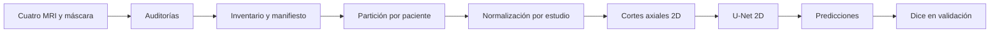

# Segmentación de gliomas cerebrales con resonancia magnética

Proyecto académico de la asignatura **Imágenes Médicas** de la Pontificia Universidad Javeriana. El repositorio reúne auditorías de BraTS 2023 Adult Glioma (BraTS-GLI), una partición por paciente, preparación de imágenes, una U-Net 2D y los resultados de un entrenamiento piloto.

> **Uso académico y experimental.** Este código no es una herramienta clínica, no ha sido validado para apoyar diagnósticos y no debe usarse para tomar decisiones sobre pacientes.

## ¿Qué problema abordamos?

Una resonancia magnética produce imágenes del cerebro en las que distintas secuencias resaltan características diferentes del tejido. **Segmentar** significa asignar una etiqueta a cada vóxel para señalar qué región pertenece al fondo y cuál corresponde a cada etiqueta tumoral. En este proyecto, una red recibe cuatro modalidades de MRI y predice una máscara con las clases 0, 1, 2 y 3.

Cada estudio incluye una máscara de referencia `seg`. Sirve para enseñar al modelo y para comparar sus predicciones durante la evaluación. La máscara no es una quinta modalidad de MRI.

## ¿Qué hemos conseguido?

- Revisamos 1.251 estudios de 1.133 pacientes. Los informes registrados contienen 6.255 archivos esperados, sin archivos faltantes ni duplicados exactos reportados. Las auditorías automáticas no marcaron estudios para revisión; esto **no** equivale a validar clínicamente cada máscara.
- Creamos un manifiesto y una partición por paciente: 793 pacientes para entrenamiento, 170 para validación y 170 para prueba. No hay identificadores de paciente compartidos entre las tres partes. La prueba permanece reservada.
- Implementamos preparación de volúmenes 3D y un conjunto de cortes axiales 2D con las cuatro modalidades como canales.
- Ejecutamos un piloto con el 30 % de los pacientes de entrenamiento y el 30 % de los de validación: 238 y 51 pacientes, respectivamente; 270 y 56 estudios. Se entrenó durante dos épocas en CPU.
- En esos 56 estudios de validación, el Dice macro medio por estudio fue **0,7024**. Es un resultado de un piloto corto, no una estimación final del desempeño ni una medida obtenida en el conjunto de prueba.

La evaluación de prueba todavía está pendiente. Consulta [resultados y evaluación](docs/06_resultados_y_evaluacion.md) para las métricas por clase, el historial y los casos extremos.

## ¿Cómo funciona?



1. **Auditoría:** revisa archivos, lectura de NIfTI, geometría, etiquetas y coincidencias exactas.
2. **Inventario y manifiesto:** reúne una fila por estudio con sus identificadores y estado de calidad.
3. **Partición:** asigna todos los estudios del mismo paciente a entrenamiento, validación o prueba.
4. **Preparación:** normaliza cada modalidad dentro del estudio, conserva los ceros y extrae cortes axiales.
5. **Modelo:** la U-Net recibe tensores con cuatro canales y predice una de cuatro clases para cada píxel.
6. **Evaluación:** el piloto reconstruye la predicción 3D del estudio y calcula Dice por clase y por estudio sobre validación.

## Organización del repositorio

```text
.
├── codigo/
│   ├── auditoria/       # Revisión del dataset y creación del manifiesto
│   ├── entrenamiento/  # Selección del piloto y entrenamiento/evaluación
│   ├── particion/      # Creación, resumen y comprobación de la partición
│   └── segmentacion/   # Lectura, normalización, cortes 2D y U-Net
├── datos/              # Copia local del dataset; está excluida de Git
├── docs/               # Guías de uso, metodología y glosario
└── resultados/
    ├── auditoria/       # Inventarios e informes CSV
    ├── modelo_piloto/   # Configuración, métricas, figuras y salidas del piloto
    ├── particion/       # split.csv, manifiesto unido y reportes
    └── segmentacion/    # Informes de normalización y frecuencias
```

El código construye sus rutas desde la ubicación de los propios scripts. Ejecuta los comandos desde la raíz del repositorio para que Python encuentre el paquete `codigo`. Los archivos NIfTI originales, checkpoints `.pth` y predicciones `.npz` están ignorados por Git; los informes y algunas figuras sí están versionados.

## ¿Cómo empezar?

Se necesita Windows, PowerShell, Python y el dataset obtenido desde su fuente autorizada. Las dependencias directas (`numpy`, `pandas`, `nibabel`, `matplotlib` y `torch`) están reunidas en [`requirements.txt`](requirements.txt), sin versiones fijadas. La instalación local disponible en este entorno registra Python 3.13.2, NumPy 2.5.4, pandas 3.0.6, nibabel 5.4.2, PyTorch 2.14.1+cpu y Matplotlib 3.11.2; son datos de este `.venv`, no una garantía para otros computadores.

En PowerShell, desde la raíz:

```powershell
python --version
python -m venv .venv
Set-ExecutionPolicy -Scope Process -ExecutionPolicy Bypass
.\.venv\Scripts\Activate.ps1
python -m pip install --upgrade pip
python -m pip install -r requirements.txt
```

Ubica el dataset en `datos/BraTS2023-GLI-Dataset/`. La estructura esperada y la guía completa están en [guía de inicio](docs/01_guia_de_inicio.md). Para comprobar una carga de ejemplo y la forma de los datos:

```powershell
python -m codigo.segmentacion.cargar_imagenes
python -m codigo.segmentacion.preparar_imagenes
```

Los informes registrados ya existen en `resultados/`. Algunos scripts los sobrescriben y otros se detienen si encuentran salidas anteriores. Lee [reproducción completa](docs/08_reproduccion_completa.md) antes de volver a generarlos.

## Resultados principales del piloto

El resumen guardado en `resultados/modelo_piloto/resumen_metricas.json` informa Dice medio por clase de 0,6214 para la clase 1, 0,7346 para la clase 2 y 0,7762 para la clase 3. El promedio macro por estudio es 0,7024, con mediana 0,7627. Se omitió una clase de un estudio cuando tanto la referencia como la predicción estaban vacías para ella.

El piloto duró dos épocas en CPU con lote de 2, tasa de aprendizaje `0.0001`, semilla 42 y 14 hilos. El historial registra 15.209 segundos hasta finalizar la segunda época (aproximadamente 4 h 13 min); el tiempo total citado para la ejecución completa es aproximado y puede variar con el equipo. La evaluación se hizo sobre validación. **No se evaluó prueba.**

## Documentación adicional

| Documento                                                      | Qué explica                                                                        |
| -------------------------------------------------------------- | ----------------------------------------------------------------------------------- |
| [Guía de inicio](docs/01_guia_de_inicio.md)                    | Python, entorno, dependencias, dataset y primera comprobación en Windows.          |
| [Datos y auditorías](docs/02_datos_y_auditorias.md)            | BraTS-GLI, modalidades, máscaras, informes y límites de las auditorías.          |
| [Manifiesto y partición](docs/03_manifiesto_y_particion.md)    | Columnas reales, generación, conteos, separación por paciente y prueba reservada. |
| [Preparación de imágenes](docs/04_preparacion_de_imagenes.md) | NIfTI, compatibilidad, normalización, cortes y formas tensoriales.                 |
| [Modelo y entrenamiento](docs/05_modelo_y_entrenamiento.md)     | U-Net, pérdida, parámetros y reproducción del piloto.                            |
| [Resultados y evaluación](docs/06_resultados_y_evaluacion.md)  | Dice, métricas guardadas, historial, predicciones y limitaciones.                  |
| [Guía del código](docs/07_guia_del_codigo.md)                 | Función, entradas, salidas y ejecución de cada script Python.                     |
| [Reproducción completa](docs/08_reproduccion_completa.md)      | Secuencia paso a paso, comprobaciones y advertencias de sobrescritura.              |
| [Problemas frecuentes](docs/09_problemas_frecuentes.md)         | Errores comunes y acciones concretas para resolverlos.                              |
| [Glosario](docs/10_glosario.md)                                 | Definiciones sencillas de los términos del proyecto.                               |
| [Metodología de partición](docs/metodologia_particion.md)     | Nota breve que remite a la explicación metodológica consolidada.                  |

## Limitaciones y próximos pasos

El entrenamiento disponible es un piloto: utiliza el 30 % de los pacientes de entrenamiento y validación por separado, solo dos épocas y CPU. Esta configuración permitió recorrer el proceso completo con recursos limitados; no se demostró que sea óptima. La prueba sigue reservada y no se usó para elegir parámetros. Hace falta ampliar y justificar el entrenamiento, evaluar una sola vez sobre prueba con el protocolo definido y revisar los resultados con criterio experto antes de extraer conclusiones. El proyecto no tiene un flujo clínico validado.
